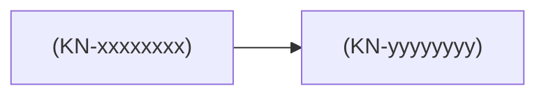

# Stay in the Loop — Project Knowledge

<!-- SITL:VIEW project_id=<PRJ-xxxxxxxx> -->

> Template: `.claude/skills/stay-in-the-loop/templates/KNOWLEDGE_VIEW_TEMPLATE.md`
> Target: `docs/learning/STAY_IN_THE_LOOP.md`
> Role: DERIVED human-facing view. Authority `docs/learning/` state dosyalarıdır. Elle düzenleme.
> Rules: `references/09_KNOWLEDGE_VIEW.md`. Yalnız içerik oluşunca oluşturulur (§2).

<!-- SITL:INDEX:START -->
## Quick Index

**Human Sync** — project comprehension

- [<label>](#hs-xxxxxxxx)
- [<label>](#hs-xxxxxxxx) · needs refresh

**Learning** — technical learning. Human Sync ≠ learned.

- [<KN-xxxxxxxx> — <canonical_name>](#kn-xxxxxxxx) · L1 L2

[Knowledge Map](#knowledge-map) · [Open Learning Debt](#open-learning-debt)
<!-- SITL:INDEX:END -->

<!-- SITL:MODEL:START -->
## Project in 60 Seconds

#### What are we building?

#### Where are we now?

#### How does it work at the highest level?

#### Five things to remember

#### What is still unresolved?

<strong>Technical Project Snapshot</strong>

#### Architecture

#### Components

#### Active Decisions

#### Invariants

#### Dependencies

<!-- SITL:MODEL:END -->

## Human Sync

<!-- SITL:HS:<HS-xxxxxxxx>:START v=<record_version> -->

### <label>

**Status:** <Current | Needs refresh>

**Tek cümlede:** <konu + işlem veya karar + sonuç>

**Anahtar kavramlar:** <basit anlam (Term)> · <basit anlam (Term)>

#### Zihinsel Model

#### Neden Önemli?

<strong>Technical Trace</strong>

#### Why

#### What Changed

#### Key Decisions

#### Dependencies

#### Open Points

#### Evidence

#### More Terms

**Record:** `<HS-xxxxxxxx>` v<record_version> · `<work_unit_id>` · `<checkpoint>`

<!-- SITL:HS:<HS-xxxxxxxx>:END -->

## Learning

<!-- SITL:KN:<KN-xxxxxxxx>:START depth=<L1;L2> -->

### <KN-xxxxxxxx> — <canonical_name>

#### Where am I?

<ROOT> → <parent> → **<canonical_name>**

Also part of: <secondary PART_OF; yoksa satır yok>

Learning depth: <L1 · L2> · Source: `<event-id>` (`<artifact path>`)

<Local Map: yalnız primary child ≥ 3 ise Mermaid flowchart LR>

#### L0 — Map

#### L1 — Simple Mental Model

#### L2 — Mechanism

<strong>L3 — Theory</strong>

<strong>L4 — Formalism</strong>

#### Boundary

#### Example

#### Retrieval

<strong>Reference</strong>

#### Related Concepts

- <RELATION> → [<name>](#kn-xxxxxxxx)
<!-- SITL:KN:<KN-xxxxxxxx>:END -->

<!-- SITL:MAP:START -->
## Knowledge Map

<!-- SITL:MAP:END -->

<!-- SITL:DEBT:START -->
## Open Learning Debt

- `<KD-...>` — <concept> · <priority> · <work_unit_ids>
<!-- SITL:DEBT:END -->
